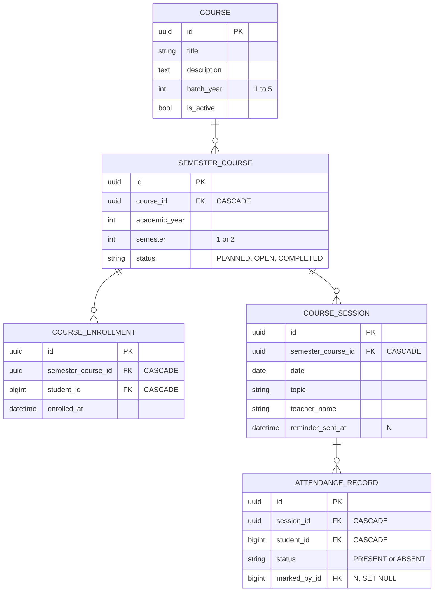
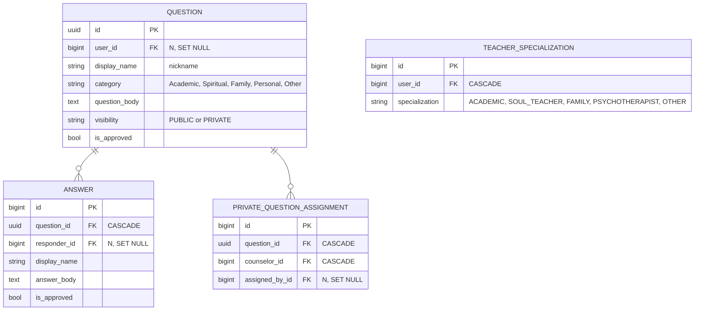

# Database design

| | |
|---|---|
| **Database** | PostgreSQL in production (Neon), SQLite for local use |
| **Access** | Django ORM; schema changes are Django migrations (`backend/*/migrations/`) |
| **Related** | [SRS](software-requirements-specification.md) · [Architecture](architecture.md) · [Roles](roles-and-permissions.md) |

This page is generated from the Django models (field types, relations, delete rules and constraints). The models in each app's `models.py` are the source of truth.

## 1. Conventions

- **Primary keys:** `bigint` auto-increment by default. `UUID` for records whose id appears in URLs or is created in bulk: student profile, course, semester course, enrolment, class day, attendance record, question, material.
- **One user table:** `core_user` (email is the unique sign-in name). Almost every table points to it.
- **Time:** all date-times are stored in UTC (`timestamptz`); a class day is a plain `date`.
- **Soft undo instead of delete:** bulk operations (account import, family distribution, yearly rollover) keep a batch row with `undone_at`, so they can be reversed.
- **Delete rules:** `CASCADE` when the child has no meaning without the parent (a membership without its group); `SET NULL` when history must stay (who created an event, who answered a question).
- **Uniqueness is enforced by the database**, not only by the application (see section 5).
- **Files** (photos, materials) are stored in Cloudinary; the tables hold only the file path or URL.

## 2. Overview diagram

Key entities and the relations that matter most (details of every table follow).

```mermaid
erDiagram
    USER ||--o{ USER_ROLE : has
    ROLE ||--o{ USER_ROLE : grants
    USER ||--|| STUDENT_PROFILE : "has (students)"
    ACCOUNT_IMPORT_BATCH ||--o{ STUDENT_PROFILE : registered
    USER ||--o{ SERVICE_GROUP_MEMBERSHIP : joins
    SERVICE_GROUP ||--o{ SERVICE_GROUP_MEMBERSHIP : has
    USER ||--o{ AGEGLOT_SELECTION : applies
    SERVICE_GROUP ||--o{ AGEGLOT_SELECTION : receives
    SERVICE_GROUP |o--o{ EVENT : "owns (optional)"
    EVENT ||--o{ SERVICE_ATTENDANCE : records
    USER ||--o{ SERVICE_ATTENDANCE : attends
    COURSE ||--o{ SEMESTER_COURSE : "opened as"
    SEMESTER_COURSE ||--o{ COURSE_ENROLLMENT : enrols
    SEMESTER_COURSE ||--o{ COURSE_SESSION : plans
    COURSE_SESSION ||--o{ ATTENDANCE_RECORD : records
    USER ||--o{ COURSE_ENROLLMENT : takes
    USER ||--o{ ATTENDANCE_RECORD : "marked for"
    FAMILY ||--o{ FAMILY_MEMBERSHIP : has
    USER ||--o| FAMILY_MEMBERSHIP : "child in"
    FAMILY ||--o{ FAMILY_MESSAGE : holds
    QUESTION ||--o{ ANSWER : has
    QUESTION ||--o{ PRIVATE_QUESTION_ASSIGNMENT : "assigned via"
    USER ||--o{ PRIVATE_QUESTION_ASSIGNMENT : counsels
    USER ||--o{ TEACHER_SPECIALIZATION : "specialises"
    PAYMENT ||--o| STUDENT_DONATION : "settles"
    PAYMENT ||--o| NON_STUDENT_DONATION : "settles"
    USER ||--o{ STUDENT_DONATION : gives
    USER ||--o{ NOTIFICATION : receives
    USER ||--o{ FCM_DEVICE_TOKEN : owns
    COURSE |o--o{ MATERIAL : has
    SERVICE_GROUP |o--o{ MATERIAL : has
```



## 3. Tables by area

Notation: **PK** primary key · **FK** foreign key · **U** unique · **N** nullable. Delete rule in brackets.

### 3.1 Identity and roles (`core`)

```mermaid
erDiagram
    USER {
        bigint id PK
        string email U
        string username U
        string first_name
        string middle_name
        string last_name
        char gender "M or F, N"
        bool is_active
        bool is_staff
        bool is_superuser
        string password "hash"
    }
    ROLE {
        int id PK
        string name U
        text description
    }
    USER_ROLE {
        bigint id PK
        bigint user_id FK
        int role_id FK
        datetime assigned_at
    }
    USER ||--o{ USER_ROLE : ""
    ROLE ||--o{ USER_ROLE : ""
```

| Table | Purpose | Notes |
|---|---|---|
| `core_user` | Every person: student, leader, admin | Extends Django's user; `email` is unique and is the sign-in name |
| `core_role` | The role catalogue | `name` in Student, SuperAdmin, ServiceAdmin, EventManager, CourseCoordinator, FamilyAdmin, QAModerator, QACounselor |
| `core_userrole` | Which user holds which role, and when | **U** (user, role); both FK `CASCADE`. A plain student has no row (Student is implied) |

### 3.2 Student profile and yearly set-up (`student`)

```mermaid
erDiagram
    STUDENT_PROFILE {
        uuid id PK
        bigint user_id FK "U, CASCADE"
        int batch_year "year of study, N"
        string department "N"
        string status "IN_CAMPUS or GRADUATED"
        datetime graduated_at "N"
        bigint import_batch_id FK "N, SET NULL"
        datetime setup_deadline "N"
        datetime setup_completed_at "N"
        string language "en, am, om"
    }
    ACCOUNT_IMPORT_BATCH {
        bigint id PK
        bigint created_by_id FK "N, SET NULL"
        int grace_days
        datetime undone_at "N"
    }
    EMAIL_VERIFICATION {
        bigint id PK
        bigint user_id FK "CASCADE"
        string new_email
        string code_hash "keyed hash"
        int attempts
        datetime expires_at
    }
    DEPARTMENT {
        bigint id PK
        string name U
        int years
        bool is_active
    }
    YEAR_ROLLOVER {
        bigint id PK
        string label
        bigint performed_by_id FK "N, SET NULL"
        int promoted
        int graduated
        int skipped
        json changes
        datetime undone_at "N"
    }
    ACCOUNT_IMPORT_BATCH ||--o{ STUDENT_PROFILE : ""
```

| Table | Purpose | Notes |
|---|---|---|
| `student_studentprofile` | The student's details | 1:1 with user. Also holds dorm block and room, section, Telegram, phone and SMS opt-in, emergency contact, home address, previous church, activity serving, confession father, photo, password-changed time and the reminder stage of the account set-up |
| `student_accountimportbatch` | One bulk registration | `grace_days` (7 to 60); `undone_at` marks an undone batch |
| `student_emailverification` | A pending 6-digit code for a new email | Only a hash of the code is stored; `attempts` and `expires_at` enforce the limits |
| `student_registrationsettings` | One row (the Super Admin's switch `allow_year_choice`, default on): may a slip student choose their own year | `StudentProfile.year_chosen_at` records the one-time choice |
| `student_department` | Departments and their program length; `is_stage` + `leads_to` (self M2M) model divisions before the final department (Pre-Engineering, a school) | A hidden (`is_active = false`) department stays on existing students; a student on a stage may change department again |
| `student_yearrollover` | One "start new year" run | `changes` (JSON) lists who moved, so it can be undone |

### 3.3 Service groups, events, families (`service`)

```mermaid
erDiagram
    SERVICE_GROUP {
        bigint id PK
        string name U
        text description
        string summary
        text activities
        text requirements
        string commitment
        string contact_info
        string photo
        string video_url
        json translations
        bigint admin_id FK "N, SET NULL"
    }
    SERVICE_GROUP_MEMBERSHIP {
        bigint id PK
        bigint student_id FK "CASCADE"
        bigint service_group_id FK "CASCADE"
        string role "MEMBER, LEADER, COORDINATOR"
        string status "ACTIVE, PROBATION, INACTIVE"
    }
    AGEGLOT_SELECTION {
        bigint id PK
        bigint student_id FK "CASCADE"
        bigint service_group_id FK "CASCADE"
        int priority "1, 2 or 3"
        text skills
        text reason
    }
    EVENT {
        bigint id PK
        string title
        text description
        datetime start_date
        datetime end_date
        string place_name
        string place_url
        bigint service_group_id FK "N, CASCADE"
        bigint created_by_id FK "N, SET NULL"
    }
    SERVICE_ATTENDANCE {
        bigint id PK
        bigint event_id FK "CASCADE"
        bigint student_id FK "CASCADE"
        string status "PRESENT or ABSENT"
        string remark
    }
    SERVICE_CONFIGURATION {
        bigint id PK
        bool is_selection_open
    }
    SERVICE_GROUP ||--o{ SERVICE_GROUP_MEMBERSHIP : ""
    SERVICE_GROUP ||--o{ AGEGLOT_SELECTION : ""
    SERVICE_GROUP |o--o{ EVENT : ""
    EVENT ||--o{ SERVICE_ATTENDANCE : ""
```

```mermaid
erDiagram
    FAMILY {
        bigint id PK
        string name U
        char gender "M or F, N"
        bigint father_id FK "U, N, SET NULL"
        bigint mother_id FK "U, N, SET NULL"
        string religious_father
        bigint created_in_batch_id FK "N, SET NULL"
    }
    FAMILY_DISTRIBUTION_BATCH {
        bigint id PK
        bigint created_by_id FK "N, SET NULL"
        datetime undone_at "N"
    }
    FAMILY_MEMBERSHIP {
        bigint id PK
        bigint family_id FK "CASCADE"
        bigint student_id FK "U, CASCADE"
        bigint batch_id FK "N, SET NULL"
    }
    FAMILY_MESSAGE {
        bigint id PK
        bigint family_id FK "CASCADE"
        bigint sender_id FK "N, SET NULL"
        bigint recipient_id FK "N, CASCADE"
        text body "max 1000"
        bool parents_only
    }
    FAMILY_DISTRIBUTION_BATCH ||--o{ FAMILY : ""
    FAMILY_DISTRIBUTION_BATCH ||--o{ FAMILY_MEMBERSHIP : ""
    FAMILY ||--o{ FAMILY_MEMBERSHIP : ""
    FAMILY ||--o{ FAMILY_MESSAGE : ""
```

| Table | Purpose | Notes |
|---|---|---|
| `service_servicegroup` | A ministry group | `admin` is the Service Admin; `translations` (JSON) is reserved for translated group content |
| `service_servicegroupmembership` | A student belongs to a group | **U** (student, group). The two-groups-at-most rule is enforced by the application |
| `service_ageglotselection` | A student's applications | **U** (student, priority) and **U** (student, group): three distinct choices |
| `service_serviceconfiguration` | One row: is selection open | A global switch |
| `service_event` | An event | `service_group` empty = general event for everyone; set = group event. The stored `status` is legacy; the live status is computed from start and end |
| `service_serviceattendance` | Present or Absent per event and student | **U** (event, student) |
| `service_family` | A mentorship family | A father and a mother are each **U**: one person leads at most one family |
| `service_familydistributionbatch` | One automatic distribution | Used for undo |
| `service_parentcandidate` | A person chosen to become a father or mother, with `status` Selected or Trained, a note and who chose them | `user` is **U**. Only Trained people can be named a parent |
| `service_familymembership` | A child in a family | `student` is **U**: a student is in at most one family |
| `service_familymessage` | A message to a family | `recipient` empty = whole family; `parents_only` marks a child's reply to the parents |

### 3.4 Courses (`course`)



| Table | Purpose | Notes |
|---|---|---|
| `course_course` | A curriculum for one year of study | |
| `course_semestercourse` | The course opened in a semester | **U** (course, academic year, semester). A many-to-many link table `course_semestercourse_coordinators` names the coordinators who may manage it |
| `course_courseenrollment` | A student takes the course | **U** (semester course, student); created automatically when the course opens |
| `course_coursesession` | One class day | **U** (semester course, date). `reminder_sent_at` makes the "class tomorrow" reminder fire once |
| `course_attendancerecord` | Present or Absent | **U** (session, student); keeps who marked it |

### 3.5 Questions and answers (`questionanswer`)



| Table | Purpose | Notes |
|---|---|---|
| `questionanswer_question` | A public or private question | A public question needs `is_approved`. If the asker's account is deleted the question stays (`SET NULL`) |
| `questionanswer_answer` | An answer | Public answers also need approval; `display_name` is how the answerer appears |
| `questionanswer_teacherspecialization` | The fields a counselor handles | **U** (user, specialization) |
| `questionanswer_privatequestionassignment` | A private question given to a counselor | **U** (question, counselor); visibility rules are in `questionanswer/visibility.py` |

### 3.6 Donations (`donation`)

```mermaid
erDiagram
    PAYMENT {
        bigint id PK
        decimal amount "10,2"
        string currency "ETB"
        string transaction_reference U
        string status "PENDING, COMPLETED, FAILED"
    }
    STUDENT_DONATION {
        bigint id PK
        bigint student_id FK "CASCADE"
        string fund_category
        bigint payment_id FK "U, CASCADE"
    }
    NON_STUDENT_DONATION {
        bigint id PK
        string first_name
        string last_name
        string email "N"
        string fund_category
        bigint payment_id FK "U, CASCADE"
    }
    PAYMENT ||--o| STUDENT_DONATION : ""
    PAYMENT ||--o| NON_STUDENT_DONATION : ""
```

| Table | Purpose | Notes |
|---|---|---|
| `donation_payment` | One payment attempt with Chapa | `transaction_reference` is unique and is what Chapa returns; the amount is a `decimal`, never a float |
| `donation_studentdonation` | A donation by a signed-in student | 1:1 with a payment. Funds: Weekly, Building fund, Charity (poor), Special events, Other |
| `donation_nonstudentdonation` | A donation by a visitor | Name and email are optional |

### 3.7 Resources (`resources`)

| Table | Purpose | Notes |
|---|---|---|
| `resources_material` | A file or a link | `material_type` COURSE, SERVICE or GENERAL. `course` or `service_group` is set for the first two. Both FK `CASCADE`; `uploaded_by` is `SET NULL` |

### 3.8 Notifications (`notifications`)

| Table | Purpose | Notes |
|---|---|---|
| `notifications_notification` | An in-app notification | `notification_type` EVENT, DONATION, REMINDER, SYSTEM or QA; `is_read` drives the bell count |
| `notifications_fcmdevicetoken` | A browser/device token for push | `device_token` is unique |
| `notifications_smsconfiguration` | One row: SMS master switch and monthly limit | Off by default |
| `notifications_smslog` | One row per SMS attempt | Indexed on `status` and `created_at`; `user` is `SET NULL` so the log survives account deletion |

### 3.8b Smart attendance (`attendance`)

| Table | Purpose | Notes |
|---|---|---|
| `attendance_attendancesession` | One scan session for an event **or** a class day | Check constraint: exactly one of `event`, `course_session` is set. Partial unique indexes: one open session (`closed_at` null) per event and per class day. `opened_by`, `closed_by` are `SET NULL`; `auto_close_at` is when the server closes a forgotten session; `helpers` M2M to users |
| `attendance_checkin` | Audit row per student checked in during a session | Unique (`session`, `student`); `method` BADGE, CODE or MANUAL; `scanned_at` is the phone time, `received_at` the server time. The Present row itself lives in `service_serviceattendance` or `course_attendancerecord` |

`student_studentprofile.badge_version` (default 1) is the number inside the student's QR badge; raising it cancels a leaked badge.

### 3.9 Framework tables
Django adds its own tables (sessions, content types, permissions, auth token, admin log, and the social-login tables). They hold no fellowship data.

## 4. Relationship summary

| Relation | Type | Meaning |
|---|---|---|
| User ↔ Role | many-to-many through `core_userrole` | A person may hold several roles |
| User → StudentProfile | one-to-one | Only students have a profile |
| User ↔ ServiceGroup | many-to-many through membership | Maximum two active groups (rule in code) |
| ServiceGroup → Event | one-to-many, optional | Empty = general event |
| User → FamilyMembership | one-to-one | One family per student |
| Family → father / mother | one-to-one each, optional | One family per parent |
| Course → SemesterCourse → Session → Attendance | chain of one-to-many | Per student through `student` |
| SemesterCourse ↔ User (coordinators) | many-to-many | Who may manage the course |
| Payment → StudentDonation or NonStudentDonation | one-to-one | A payment belongs to exactly one kind of donor |

## 5. Constraints enforced by the database

| Table | Constraint |
|---|---|
| `core_user` | `email` unique, `username` unique |
| `core_role` | `name` unique |
| `core_userrole` | unique (user, role) |
| `student_studentprofile` | `user` unique (one-to-one) |
| `student_department` | `name` unique |
| `service_servicegroup` | `name` unique |
| `service_servicegroupmembership` | unique (student, service_group) |
| `service_ageglotselection` | unique (student, priority); unique (student, service_group) |
| `service_serviceattendance` | unique (event, student) |
| `service_family` | `name` unique; `father` unique; `mother` unique |
| `service_familymembership` | `student` unique |
| `course_semestercourse` | unique (course, academic_year, semester) |
| `course_courseenrollment` | unique (semester_course, student) |
| `course_coursesession` | unique (semester_course, date) |
| `course_attendancerecord` | unique (session, student) |
| `questionanswer_teacherspecialization` | unique (user, specialization) |
| `questionanswer_privatequestionassignment` | unique (question, counselor) |
| `donation_payment` | `transaction_reference` unique |
| `donation_studentdonation`, `donation_nonstudentdonation` | `payment` unique |
| `notifications_fcmdevicetoken` | `device_token` unique |

Rules the database cannot express and the application enforces (each has tests): the year of study each role needs; at most two service groups per student; at least one Super Admin; who may see a private question; a Course Coordinator only on the courses where named.

## 6. Indexes
Primary keys, unique constraints and foreign keys are indexed by Django. In addition `notifications_smslog.status` and `.created_at` are indexed for the SMS report. The expected size (about a thousand students, a few thousand attendance rows per semester) does not need further indexes; add them from query plans if the data grows.

## 7. Data lifecycle and privacy

| Data | Kept | Removed |
|---|---|---|
| Students and their history | While active; graduates keep everything | Only on a Super Admin's explicit action |
| Passwords | Salted hash only, never exported | |
| 6-digit codes | Keyed hash, 15 minutes | Replaced or expired |
| Login slip passwords | Shown once at creation, not stored in plain text | |
| Private questions | Visible to the asker, assigned or matching counselors, Super Admin | If the asker's account is deleted the question remains without an owner |
| Donations | Kept for reporting | |
| Notifications | Per user | Removed with the user |

## 8. Migrations and backups

- Schema changes are made only through migrations committed with the code (`python manage.py makemigrations`, then `migrate`).
- Production backups: the database provider's point-in-time restore (Neon). Before any bulk delete, preview first and confirm the backup exists.
- Exports for reporting: Excel files from the Super Admin Export page (never include passwords).

## 9. How to regenerate this page's facts

From `backend/`, with the test settings, a short script can list every model, field, relation and constraint:

```python
import django, os
os.environ["DJANGO_SETTINGS_MODULE"] = "config.settings_test"
django.setup()
from django.apps import apps
for m in apps.get_models():
    print(m._meta.label, [f.name for f in m._meta.get_fields()])
```

## Email outbox (`notifications`)

- `EmailConfiguration` (one row): `daily_limit` (default 300).
- `EmailOutbox`: `user`, `email`, `kind` (NEW_EVENT, EVENT_TOMORROW), `event`, `subject`, `body`, `not_after` (skip after the
  event start), `status` (WAITING, SENDING, SENT, FAILED, SKIPPED), `attempts`, `error`, `created_at`, `claimed_at`, `sent_at`.
- `Event.reminder_sent_at`: when the "event tomorrow" reminder was queued (once per event).
